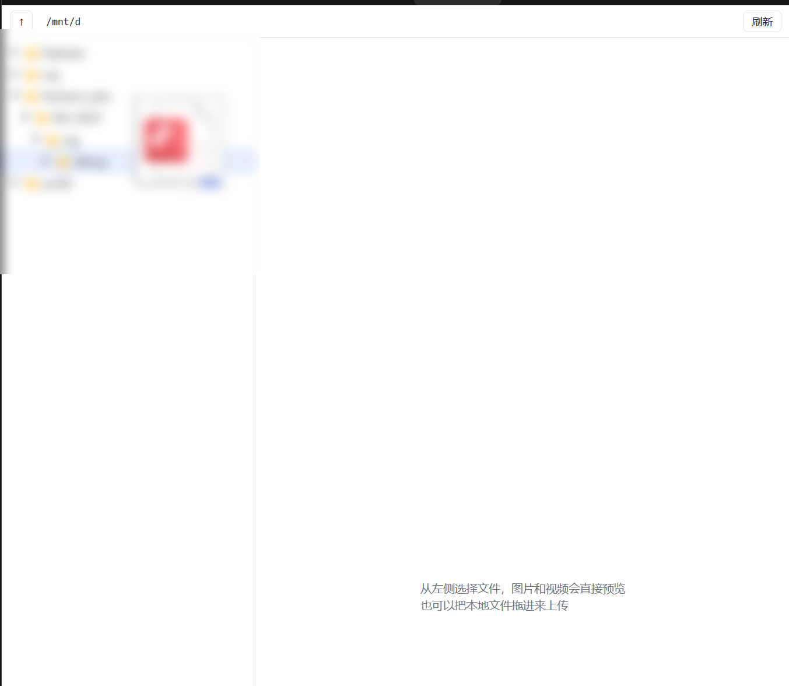
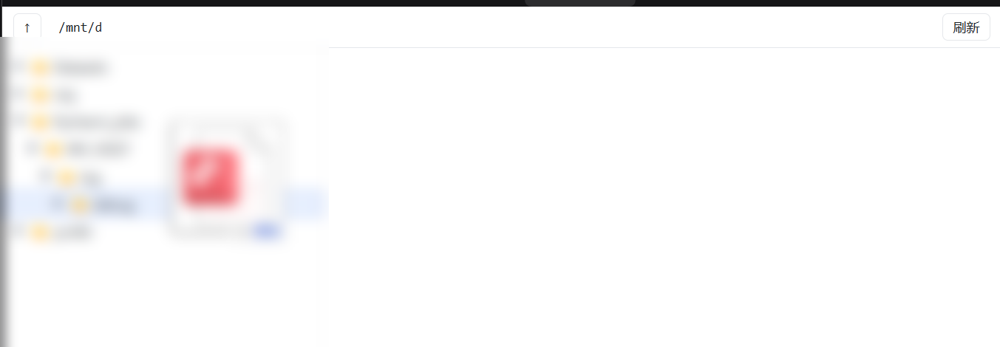

# dsh-file-explorer

A [DeepSeek Harness](https://github.com/deepseek-ai/deepseek-harness) plugin that puts a **VSCode-like file tree for a remote SSH directory** into the Web GUI: a left-rail entry, a dockable right-sidebar tab, inline image preview, Range-streamed video, and drag-and-drop upload.



中文说明见 [README.md](README.md).

---

## What you get

```
left rail "Files" ─┐
                   ├─ main area: full-page tree
right sidebar + ───┘   editable path bar, lazy folders, per-type icons
                       ┌─────────────────────────────
                       │ preview: image · video · text
                       └─────────────────────────────
```

- **Three surfaces, one page**: left-rail entry (full page), right-sidebar tab (side by side with the conversation), and plain `http://127.0.0.1:8910/` in any browser.
- **Editable path bar**: starts at `treeRoot`, type any absolute path and press Enter; `↑` goes up.
- **Preview**: images inline, video through HTTP Range (no full download), text up to 256 KiB.
- **Drag and drop**: drop files from Explorer/Finder onto a folder row (or the tree) to upload them via `rclone rcat`.

  
- **Right-click menu**: copy absolute/relative path, rename, move to…, delete, new folder; right-click the empty area for folder actions on the current directory.
- **Read-only by default for reads**: bound to `127.0.0.1`; uploads can be disabled with `allowUpload: false`.

## Requirements

| Requirement | Notes |
|---|---|
| DeepSeek Harness ≥ 0.2.2 | needs `sidebar.panellist`, `main`, `sidebarRightTabs` |
| [rclone](https://rclone.org/) | the only external binary; does SFTP and byte ranges |
| OpenSSH key | password-less login to the target host |

```powershell
choco install rclone -y     # Windows
brew install rclone         # macOS
```

## Install

**From the plugin market** (once published): add the index URL, then install `dsh-file-explorer`.

**From this repository**:

```powershell
git clone https://github.com/BruceYounggit/dsh-file-explorer.git
cd dsh-file-explorer
.\scripts\install.ps1 -SshHost 10.0.0.5 -SshPort 22 -TreeRoot /srv/data
```

The script links the package into `<profile>/node_modules/dsh-file-explorer` and appends a loader entry to `<profile>/cordis.patch.yml`. Restart DeepSeek Harness afterwards.

Uninstall: `.\scripts\uninstall.ps1`.

## Configuration

Either in the loader entry (`config:`) or in `$DSH_HOME/file-explorer.json` — the entry wins. See [file-explorer.example.json](file-explorer.example.json).

| Field | Default | Meaning |
|---|---|---|
| `treeRoot` | `/` | default starting directory, not a boundary |
| `restrictToTreeRoot` | `false` | refuse paths outside `treeRoot` |
| `allowUpload` | `true` | accept `POST /api/upload` |
| `allowWrite` | `true` | allow rename, move, delete and mkdir |
| `treePort` | `8910` | loopback port (must match `TREE_URL` in `lib/client.js`) |
| `ssh.host` / `ssh.port` / `ssh.user` | empty / `22` / `root` | SFTP target |
| `ssh.keyFile` / `ssh.knownHosts` | empty | key paths |
| `sources` | `[]` | extra local folders served as rclone HTTP directories |

## How it works

```
DeepSeek Harness (Electron / Web)
├─ lib/client.js   browser plugin: left-rail entry, main page, right-dock tab
└─ lib/index.js    host plugin (Node)
   ├─ GET /                          → lib/explorer.html
   ├─ GET /api/list?path=…           → rclone lsjson
   ├─ GET /api/file?path=… (Range)   → rclone cat --offset --count
   └─ POST /api/upload?path=&name=   → rclone rcat (stdin stream)
```

The page is plain HTML/CSS/JS; folders load lazily and uploads stream straight through the host process.

## Security

- Every service binds `127.0.0.1` only.
- Reads use `cat`/`lsjson`; writes exist only behind the upload and context-menu endpoints, each switchable with `allowUpload` / `allowWrite`.
- `restrictToTreeRoot: true` confines both reads and writes to one subtree.
- No credentials are stored; SSH auth is delegated to `ssh`/rclone.

## Limitations

- Windows-first tooling (the install script is PowerShell); the host half itself is cross-platform.
- One `treeRoot` per install; no search, sorting, rename, delete or multi-host switching yet.
- Video start is one SSH round-trip slower than a local file.
- Port `8910` is fixed for the client URL.

## Development

Edit `lib/*.js` and toggle the plugin entry (or restart) — there is no build step. Edit `lib/explorer.html` and reload the page.

## License

MIT
