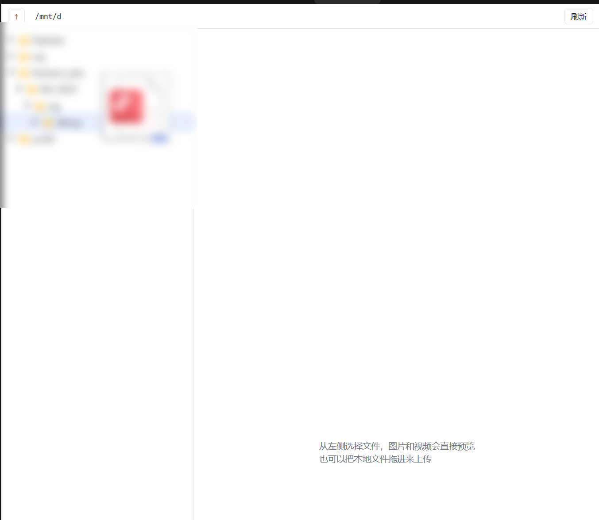
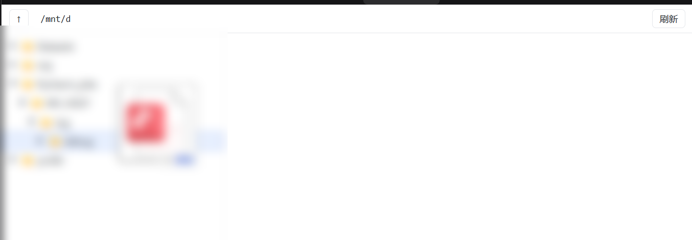

# dsh-file-explorer

给 [DeepSeek Harness](https://github.com/deepseek-ai/deepseek-harness) 加一个**远程服务器文件树**：左侧栏入口、右侧栏可停靠标签，VSCode 风格的目录树，点开就能看图片、直接播放视频。

A DeepSeek Harness plugin that renders a VSCode-like file tree for a remote SSH directory, with inline image preview and Range-streamed video playback.



---

## 它长什么样

```
左侧栏「文件」 ──┐
                 ├── 主区域：整页文件树（点开文件夹逐层展开）
右侧栏 + →「文件树」┘        服务器目录树
                          ├─ 📁 DCR/
                          ├─ 📁 LHM-plusplus/
                          └─ 📄 CLAUDE.md        22 KB
                          ┌──────────────────────────────
                          │ 右侧预览：图片直接显示
                          │ 视频原生播放器，可拖进度条
                          └──────────────────────────────
```

- **三种入口，同一个页面**：左侧导航栏入口（全屏）、右侧栏标签（和对话并排）、以及独立浏览器窗口 `http://127.0.0.1:8910/`。
- **顶部路径栏可编辑**：默认从 `treeRoot` 开始，输入任意绝对路径回车即可跳转（`↑` 回上一级、`刷新` 重载当前目录）。
- **拖拽上传**：从资源管理器拖文件到目录行（或树空白处）即可上传到该目录，走 `rclone rcat` 流式写入，带进度提示。

  
- **右键菜单**：复制绝对路径 / 复制相对路径、重命名、移动到…、删除、在此新建文件夹；空白处右键可新建文件夹、复制当前目录路径、刷新。
- **右侧栏标签能分割、能浮动**：一边对话一边看文件；浮动面板切换会话也不会被关掉。
- **预览**：图片直接显示；视频用 HTTP Range 流式播放（不整段下载）；文本/代码显示前 256 KB；其它类型给下载/新窗口链接。
- **只读为主**：服务只绑 `127.0.0.1`；默认允许浏览任意绝对路径，可用 `restrictToTreeRoot: true` 限制在起始目录子树内；上传可用 `allowUpload: false` 关闭。

## 依赖

| 依赖 | 说明 |
|---|---|
| DeepSeek Harness ≥ 0.2.2 | 需要 `sidebar.panellist` / `main` / `sidebarRightTabs` 槽位 |
| [rclone](https://rclone.org/) | 唯一的外部程序，负责 SFTP 读取与字节范围读取 |
| OpenSSH 密钥 | 到目标服务器的免密登录（`BatchMode` 可用） |

```powershell
choco install rclone -y    # 或从 rclone.org 下载解压后加入 PATH
```

## 安装

**方式一：插件市场（推荐）**

在 DSH 里添加索引地址，然后在市场里安装 `@bruce_young/dsh-file-explorer`：

```
https://bruceyounggit.github.io/dsh-file-explorer/index.json
```

索引文件是仓库根目录的 [`index.json`](index.json)，已通过官方 `parseMarketIndex` 校验；`0.3.0` 同时提供 npm 源与 Git 源。

**方式二：从仓库安装**

```powershell
git clone https://github.com/BruceYounggit/dsh-file-explorer.git
cd dsh-file-explorer

.\scripts\install.ps1 `
  -SshHost 203.0.113.10 `
  -SshPort 22 `
  -TreeRoot /srv/data
```

脚本会做两件事：把仓库联接进 `<profile>/node_modules/dsh-file-explorer`，并在 `<profile>/cordis.patch.yml` 末尾插入一条带配置的 loader 条目。之后**重启 DeepSeek Harness**（或在插件列表里停用再启用该条目）即可。

卸载：

```powershell
.\scripts\uninstall.ps1
```

## 配置

条目配置既可以写在 `cordis.patch.yml`，也可以放在 `$DSH_HOME/file-explorer.json`（默认 `~/.dsh/file-explorer.json`），条目配置优先级更高。示例见 [`file-explorer.example.json`](file-explorer.example.json) 和 [`cordis.patch.example.yml`](cordis.patch.example.yml)。

| 字段 | 默认 | 说明 |
|---|---|---|
| `treeRoot` | `/` | 文件树的**默认起始目录**；不是边界 |
| `restrictToTreeRoot` | `false` | 设 `true` 则只允许访问 `treeRoot` 子树 |
| `allowUpload` | `true` | 是否接受 `POST /api/upload` 拖拽上传 |
| `allowWrite` | `true` | 是否允许重命名 / 移动 / 删除 / 新建文件夹 |
| `treePort` | `8910` | 本机端口；改端口需同步改 `lib/client.js` 的 `TREE_URL` |
| `ssh.host` | 空 | 空则不启动树服务 |
| `ssh.port` | `22` | SSH 端口 |
| `ssh.user` | `root` | 登录用户 |
| `ssh.keyFile` | 空 | 私钥路径 |
| `ssh.knownHosts` | 空 | known_hosts 路径 |
| `sources` | `[]` | 额外的本地目录，每个起一个 rclone HTTP 目录（`id`/`path`/`httpPort`） |

## 工作原理

```
DeepSeek Harness（Electron / Web）
├─ lib/client.js      浏览器插件：注册左侧入口、主区页面、右栏标签
│                     └─ 三个入口都是同一个 iframe
└─ lib/index.js       Host 插件：Node 进程内
   ├─ http://127.0.0.1:8910/            ── lib/explorer.html（树 + 预览）
   ├─ GET /api/list?path=…               └─ rclone lsjson
   ├─ GET /api/file?path=…（Range）      └─ rclone cat --offset --count
   └─ http://127.0.0.1:89xx/             └─ 可选的本地目录（rclone serve http）
```

树页面是纯 HTML/CSS/JS，不依赖宿主框架；目录按需懒加载，视频靠 `Accept-Ranges` 边看边取。

## 安全

- 所有服务只监听 `127.0.0.1`，不对外暴露。
- 只读接口用 `cat`/`lsjson`；写操作只有上传和右键菜单那几个接口，都可用 `allowUpload` / `allowWrite` 单独关掉。
- `restrictToTreeRoot: true` 时，读写都被限制在 `treeRoot` 子树内。
- 插件不做任何写操作以外的事情，也不接触凭据；SSH 认证交给系统 `ssh`/rclone。

## 已知限制

- Windows 优先（安装脚本是 PowerShell，`taskkill` 用于回收端口）；Linux/macOS 的 Host 半边可直接用，但脚本需自行改写。
- 一次只服务一个 `treeRoot`；没有搜索、排序、右键菜单、上传。
- 视频首次播放比本地文件慢一拍：每个 Range 请求都要一次 SSH 往返。
- 端口固定为 8910（客户端 URL 常量），被占用时树服务会启动失败并在日志里报错。

## 目录结构

```
lib/index.js       Host 半边（树 API + 本地目录桥）
lib/client.js      浏览器半边（槽位注册）
lib/explorer.html  树 + 预览页面
scripts/           安装 / 卸载脚本
cordis.patch.example.yml
```

## 开发

改完 `lib/*.js` 不需要构建：重启插件条目（插件列表停用/启用）即可让 Host 重新 import、浏览器重新拉模块。改 `explorer.html` 只需刷新页面。

## License

MIT
